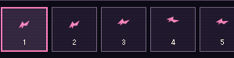
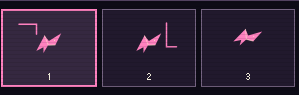
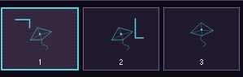

# PR #58 operation-quality repair — implementation evidence

This directory records the implementer's work, not the independent re-review.
Original review target: `f21f0a8c17a04be02da327e82d6662ed51c54d6e`, tree
`263dff6c0268bb2c057b7a932ac730df2aa9c935`. The PR was open, Draft, unmerged,
base `main` at `d71411a0a635ec1f69d9fa16b717b3880e02054a` when retrieved.
The independent review `5753482433` and all three comments were retrieved anew.
No previous evidence or review was overwritten. A fresh checkout was used.

Product repair commit: `842142bb46d6d26aed696736cb6fec7ea3a4918c`, tree
`32afa597cbf1179b3154fc70458a3d559e8aa3b4`, branch
`feat/flash-then-now-phase2`. Later evidence commits retain those product files.
The final submission SHA, CI and independent disposition are in the PR discussion.

## Confirmed causes and choices

1. **Filmstrip omitted custom artwork.** Stage and onion skin included `DrawingInk`,
   but thumbnails rendered only `PaperBird`. Copying a pose, replacing its ink,
   and returning to the source produced different stage drawings with identical
   thumbnail rasters. All four old 375px engine/era cases had **zero changed pixels**.
   Data retention therefore did not meet the acceptance criterion.
   `FrameArtwork` now renders the pose and ink for all three destinations.
   Thumbnail width is 80px instead of 44px, lines have a 1.5px non-scaling minimum,
   and single-point strokes remain visible. Coordinates and frame data are shared;
   there is no second drawing model. Merely adding labels or data assertions was
   rejected because it would not show the actual edit.

2. **A drawing was implicitly addressed as the last stroke in the selected frame.**
   Undo removed that stroke without ending the pointer session, so a later move
   could append to an earlier, already committed stroke. The session now owns
   `(pointerId, frameIndex, strokeIndex)`; Undo, other edits, selection, duplication,
   playback and activity/reduced-motion changes end it. Up/cancel/capture loss end
   only the matching pointer. Unit counterexamples include unrelated-pointer
   cancellation and switching frames while a pointer is still held.

   Cancellation policy **B** was selected: retain the partial line already shown,
   as one stroke removable with the existing single-line Undo. Policy A would
   discard visible work when the browser interrupts input. No extra history or
   persistence system was introduced. The policy is explained beside the exhibit.

3. **Mask's two-axis operation competed with vertical native panning.**
   In old Chromium trusted touch, vertical dragging produced trusted pointercancel,
   page scroll, and an endpoint near `(128,95)` instead of `(128,172.5)`.
   `touch-action:none` is now limited to Mask's picture; the rest of the page still
   scrolls and the position sliders remain available. A pointer owner and explicit
   up/cancel/capture-loss handling reject stale moves after termination.
   Parallax's horizontal `pan-y` surface is unchanged.

4. **Additional root cause discovered during the repair: native SVG text dragging.**
   First repair attempts still failed one Chromium 375px Then sequence.
   Input tracing showed selected `FRAME 01 / 7 · 6 FPS`, trusted `dragstart`, then
   trusted pointercancel; the subsequent Undo received **no keydown/keyup/click**.
   It was not a slow React commit or a successful Undo followed by corruption.
   Drawing and Mask now suppress native text selection/default dragging on their
   owned picture gestures. Drawing explicitly retains focus with `preventScroll`.
   The same sequence subsequently delivered trusted keydown → click → keyup and
   preserved the committed line. No timeout, sleep, retry or forced click was added.

## Evidence and finite experiments

| Directory / log | Meaning |
| --- | --- |
| `old/` | Initial sandbox localhost denial; **not** a product reproduction |
| `old-browser/` | Old product, Chromium/WebKit ×375px ×Then/Now: 4 FAIL, missing thumbnail ink and zero raster differences |
| `old-touch/`, `new-touch/` | Initial synthetic WebKit pointerdown could not establish real pointer capture; these trials include harness errors and are not native touch evidence |
| `old-touch-real-input/` | Trusted Chromium touch; trusted WebKit mouse with explicit synthetic cancel. Native WebKit touch remains NOT_TESTED |
| `new-editing/`, `new-editing-observed/` | Intermediate repair: 15/16 PASS; the remaining case failed input activation, retained as FAIL |
| `undo-input-diagnosis/`, `undo-native-drag-diagnosis/` | Targeted input/selection/drag tracing confirming the fourth cause above |
| `native-drag-fixed/` | Same Chromium375 Then/Now sequence after native-drag suppression: 2 PASS |
| `final-editing/` | Fixed product, Chromium/WebKit ×375/390/765/1280 ×Then/Now: **16/16 PASS** |
| `negative-hidden-ink/` | CSS hides thumbnail ink while SVG data remain; **2/2 expected FAIL**, only raster checks reject it, process exit 1 |
| `final-touch-chromium/` | Trusted touch horizontal/vertical/diagonal/reversal/cancel ×Then/Now: **10/10 PASS**, normal page scroll PASS |
| `final-touch-webkit/` | **10/10 PASS**, trusted mouse operations and explicit synthetic cancel; native touch is not inferred from this result |
| `final-six-works/` | First full local suite stopped during initial navigation, zero exhibit cases; not counted as a 48-case pass |
| Local supplemental `six-works-network-observed/` | One bounded comparison with request logging only; same assertions and original 10s timeout; wrapper source is `full-observed.mjs.txt`. This ongoing output is separate from this committed evidence snapshot; its final status is recorded in the PR comment |
| `local-tests.log` | First shell-wrapper attempt: Node49 PASS, then missing npm `.bin` PATH; not a full test pass |
| `local-tests-with-path.log` | Intermediate product's full suites pass; distinct from final results |
| `final-*.log` | Final lint/type/build and tests; **Node49 + Vitest369 = 418 PASS**, no skipped tests |

The initial new unit counterexamples also exposed decimal string expectations
(`30` vs `29.999999999999996`). Exact integer-representable fixture coordinates
were used instead; the state/identity requirements were not weakened.
Experiments were bounded by those new observations; there is no retry loop.

Repair code commit `842142b` completed **5 workflows / 17 jobs, all success**:
[phase2](https://github.com/tetsujisugimori-coder/Loading-museum/actions/runs/41655331313),
[museum](https://github.com/tetsujisugimori-coder/Loading-museum/actions/runs/41655331314),
[physics](https://github.com/tetsujisugimori-coder/Loading-museum/actions/runs/41655331157),
[Stage2B](https://github.com/tetsujisugimori-coder/Loading-museum/actions/runs/41655331177),
[Stage2A](https://github.com/tetsujisugimori-coder/Loading-museum/actions/runs/41655331435).
The evidence submission commit must receive its own final-HEAD CI confirmation;
the above success is not silently assigned to another SHA.

The 16 final editing cases separately check stage data, copied-frame independence,
stage/thumbnail SVG correspondence, raster visibility, different-ink identification,
Undo, onion off, Then/Now separation, cancellation retention, stale input after Undo,
trusted Undo activation, no native drag, and Reset. At native thumbnail size,
edited-vs-blank differences were **65–70 pixels** and different-drawing differences
were **136–163 pixels** (per-channel difference >20). This is a mechanical raster
counterexample, supplemented by visual inspection, not a general visual acuity metric.

### Native-size visual comparison, 375px

Old Then filmstrip — the two independently edited frames have identical art:

Fixed Then filmstrip — the differently positioned L-shaped strokes identify the frames:

## Continuous protection

The existing Flash phase2 workflow retains its original 48-case browser suite.
It additionally runs editing/raster and touch/pointer regressions per engine,
using `pipefail`; evidence and all three logs are uploaded with `always()`.
Failed operations retain nonzero exit codes. No skip/retry/timeout relaxation was
introduced. Physical Safari, VoiceOver and OS backgrounding remain NOT_TESTED.

All inventory data, existing IDs/categories, phase1 components, room registration,
Reset/mount/clock gates and package-lock are unchanged from the reviewed HEAD.
The exact **257 exhibits / Flash66 / 13 rooms / Flash18 categories** contracts and
old exhibit digests remain in the full tests. #29/#44/#54 remain separate.
There is no external saving, production data, publish, deploy, Draft release or merge.

## Independent review handoff

This implementation/self-verification must not be described as the independent
review. A different session/persona on the same host and another checkout handles
that review; this is **not a separate machine**. The code commit above is fixed for
that purpose. Focus: native-size thumbnail recognition; stage/list consistency after
copy/edit/Undo/onion/Reset; unrelated pointer cancellation and stale input; SVG text
drag suppression; Mask picture-vs-page scrolling; Then/Now artistic differences;
and checking that the raster negative control fails for visibility rather than data.

Merge disposition is provisional until the final-HEAD CI and that separate review.
